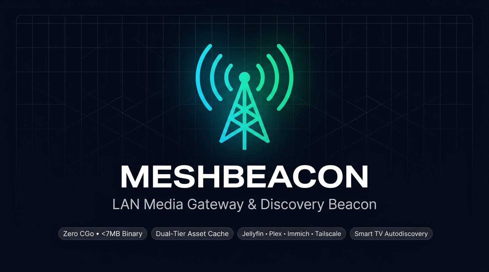

<p align="center">
  
</p>

# Meshbeacon

> **Smart TV discovery beacon (UDP/mDNS), stream gateway, and local asset cache for Jellyfin, Plex, Immich, Audiobookshelf & self-hosted homelab services across Tailscale and WireGuard meshes.**  
> *Stream media, browse photo timelines, and proxy homelab services to local devices with native auto-discovery and zero client VPNs.*

[](https://github.com/shimco/meshbeacon/actions/workflows/ci.yml)
[](https://github.com/shimco/meshbeacon/actions/workflows/docker.yml)
[](https://github.com/shimco/meshbeacon/pkgs/container/meshbeacon)
[](go.mod)
[](LICENSE)
[](https://github.com/shimco/meshbeacon/releases)

---

## The Problem

Running VPN clients directly on Smart TVs (Google TV, Android TV, Apple TV, Fire TV, Roku) causes chronic friction:
1. **Aggressive Standby Sleep:** Android TV and Smart TV platforms aggressively kill background VPN processes to conserve memory during standby. Waking the TV leaves tunnels like Tailscale dead and media apps buffering indefinitely.
2. **Family Support Overhead:** Explaining VPN client toggles, MFA, or private IP configuration to non-technical partners, kids, or parents is an ongoing support burden.
3. **Plex Relay Throttling:** Without local network presence, Plex falls back to its 2 Mbps internet relay, forcing heavy video transcoding on your server.

## The Solution

**Meshbeacon** is a lightweight local LAN gateway and discovery beacon. You run it on a single machine on your local network (a Raspberry Pi, mini-PC, NAS, home server, or OpenWrt travel router).

Meshbeacon bridges your remote server into your local home Wi-Fi:
* **Native Local Auto-Discovery:** Emulates local server discovery probes (UDP `7359` for Jellyfin, GDM UDP `32414` for Plex, and mDNS/DNS-SD `_jellyfin._tcp`) so TV apps find the server automatically.
* **Modular Multi-Service Engine:** Natively bridges and caches **Jellyfin** (UDP 7359 / mDNS), **Plex** (GDM UDP 32414), **Immich** (photos & thumbnail timeline cache), **Audiobookshelf** (audio streaming & book covers), **Navidrome** (music & album art), **Kavita** (manga/e-books), and generic HTTP/mDNS services.
* **Zero Client Installs:** TVs, streaming sticks, and family devices connect directly over standard local Wi-Fi without VPN software.
* **Zero-Allocation 4K Streaming:** Hardened reverse proxy using pooled 32KB buffers (`sync.Pool`) delivers high-throughput video streaming with near-zero CPU and <10MB of RAM.
* **Dual-Tier Asset Caching:** Stores posters, photo thumbnails, and album artwork in RAM or local NVMe with zero SD-card wear, making browsing fast over high-latency WAN links.

---

## Architecture

```text
 ┌────────────────────────────────────────────────────────┐
 │              Offsite Media Server / NAS                │
 │    (Plex, Jellyfin, Jellyseerr, Immich, Navidrome)     │
 └───────────────────────────┬────────────────────────────┘
                             │
                      Encrypted Overlay
          (Tailscale / WireGuard / ZeroTier / Nebula)
                             │
                             ▼
 ┌────────────────────────────────────────────────────────┐
 │                 Meshbeacon Gateway                     │
 │          (Raspberry Pi / Home Server / Docker)         │
 │                                                        │
 │  ┌───────────────────────┐   ┌───────────────────────┐ │
 │  │   Streaming Proxy     │   │   Discovery Beacon    │ │
 │  │   (HTTP/WebSockets)   │   │  (UDP 7359, GDM, mDNS)│ │
 │  └───────────────────────┘   └───────────────────────┘ │
 └───────────────────────────┬────────────────────────────┘
                             │
                       Local Home LAN
                      (Wi-Fi / Ethernet)
                             │
       ┌─────────────────────┼─────────────────────┐
       ▼                     ▼                     ▼
┌──────────────┐      ┌──────────────┐      ┌──────────────┐
│   Smart TV   │      │   Apple TV   │      │    iPads     │
│  (No VPN)    │      │  (Stock App) │      │  (Guests)    │
└──────────────┘      └──────────────┘      └──────────────┘
```

---

## Supported Services & Discovery Profiles

| Service | Discovery Protocol | What Meshbeacon Does |
| :--- | :--- | :--- |
| **Jellyfin** | UDP `7359` broadcast & mDNS (`_jellyfin._tcp`) | Emulates server beacon for Smart TVs; proxies 4K streams; caches movie posters |
| **Plex** | GDM UDP `32414` & mDNS (`_plexmediasvr._tcp`) | Answers GDM discovery probes; forces Direct Play; bypasses 2 Mbps cloud relays |
| **Immich** | mDNS (`_immich._tcp` / `_http._tcp`) | Local photo backup discovery; caches timeline thumbnails and asset grids |
| **Audiobookshelf** | mDNS (`_audiobookshelf._tcp`) | Auto-discovery for mobile apps; streams audiobooks; caches book cover art |
| **Navidrome** | mDNS (`_subsonic._tcp`) | Subsonic client discovery; streams music; caches album covers |
| **Kavita / Mealie** | mDNS (`_http._tcp`) | Local discovery for reading & recipe apps; caches covers and recipe images |
| **Generic HTTP** | Custom mDNS DNS-SD record | Reverse-proxy any homelab dashboard, printer (IPP), or companion app (Jellyseerr/Overseerr) |

---

## Quick Start

### Docker Compose (Recommended)

1. Create `meshbeacon.json` pointing to your remote server:
   ```json
   {
     "advertise_addr": "auto",
     "services": [
       {
         "name": "jellyfin",
         "local_port": 8096,
         "upstream_url": "http://media-server.your-tailnet.ts.net:8096",
         "discovery": { "type": "jellyfin", "port": 7359 }
       },
       {
         "name": "plex",
         "local_port": 32400,
         "upstream_url": "http://media-server.your-tailnet.ts.net:32400",
         "discovery": { "type": "plex", "port": 32414 }
       },
       {
         "name": "immich",
         "local_port": 2283,
         "upstream_url": "http://photos.your-tailnet.ts.net:2283",
         "discovery": { "type": "immich" }
       }
     ]
   }
   ```

2. Run with `docker-compose.yml`:
   ```yaml
   services:
     meshbeacon:
       image: ghcr.io/shimco/meshbeacon:latest
       container_name: meshbeacon
       restart: unless-stopped
       network_mode: host
       command: ["-config", "/etc/meshbeacon/meshbeacon.json"]
       volumes:
         - ./meshbeacon.json:/etc/meshbeacon/meshbeacon.json:ro
   ```

3. Launch:
   ```bash
   docker compose up -d
   ```

### Homebrew (macOS & Linux)

```bash
brew tap shimco/tap
brew install meshbeacon
brew services start meshbeacon
```

*(For Debian/Ubuntu `.deb`, Raspberry Pi automated script, or OpenWrt travel routers, see the [Getting Started Guide](docs/getting-started.md)).*

---

## Documentation & Deep Dives

| Guide | Description |
| :--- | :--- |
| **[Getting Started & Installation](docs/getting-started.md)** | Step-by-step guides for Docker, Homebrew, Debian/Ubuntu `.deb`, standalone script, OpenWrt, plus configuration reference. |
| **[Plex Direct Play Resolution](docs/plex-direct-play.md)** | Resolving Custom Access URLs and LAN subnets to bypass the 2 Mbps Plex Relay and force full quality Direct Play. |
| **[Hardware Caching Strategy](docs/caching-strategy.md)** | Memory auto-scaling brackets (8MB on micro-routers to 512MB on servers), NVMe persistence, and zero flash wear design. |
| **[Why Meshbeacon? Comparing Architectural Alternatives](docs/alternatives-comparison.md)** | Detailed technical comparisons against Squid caching, Tailscale Services, and pairing with AdGuard Home. |
| **[Smart TV Tips & Troubleshooting](docs/smart-tv-troubleshooting.md)** | Resolving Wi-Fi multicast blocking, IGMP snooping, DHCP reservations, and Apple TV Swiftfin permissions. |
| **[Multi-Server Proxying & Federation](docs/multi-server-federation.md)** | Exposing multiple Jellyfin or Plex servers on separate ports across the same living room Wi-Fi. |

---

## Core Capabilities

- [x] **Jellyfin LAN Discovery:** Listens for broadcast probes (`Who is JellyfinServer?`) on UDP port `7359` and actively announces presence across subnets.
- [x] **Plex GDM Discovery:** Responds to Plex "Good Day Mate" UDP discovery queries on port `32414`.
- [x] **mDNS / DNS-SD Broadcasting:** Publishes `_jellyfin._tcp` and `_plexmediasvr._tcp` zero-conf records for Apple TV (Swiftfin), Infuse, and iOS clients.
- [x] **Zero-Config Identity Detection:** Automatically queries upstream server endpoints (`/System/Info/Public` and `/identity`) to fetch Server IDs and names (no manual UUID configuration needed).
- [x] **Zero-Allocation 4K Streaming:** Hardened Go reverse proxy with pooled 32KB buffers (`sync.Pool`) for high-bitrate streaming with minimal RAM usage.
- [x] **Dual-Tier Caching:** In-memory LRU cache scaled to hardware (8MB to 512MB) to eliminate SD card wear, with an optional persistent SSD/NVMe tier.
- [x] **Extensible Service Proxy:** Stream and cache companion apps like Jellyseerr, Overseerr, Immich, Navidrome, or Audiobookshelf.
- [x] **Embedded Web Dashboard & Standby Setup:** Zero-dependency web UI on port `7350` (`http://meshbeacon.local:7350`) with first-run setup wizard and live cache metrics.
- [x] **OpenWrt & LuCI Integration:** Auto-installing `procd` service and LuCI menu integration under **Services -> Meshbeacon** for travel routers (e.g. GL.iNet Beryl AX).
- [x] **Safe Self-Updater & Pre-flight Testing:** Standalone binary updates with SHA-256 checksum verification, pre-flight config validation, and rollback safety net (`meshbeacon -update`).
- [x] **Cross-Platform Static Binaries:** Pure Go (`CGO_ENABLED=0`) with zero external libc runtime dependencies (x86_64, ARM64, ARMv7, MIPS/MIPSEL for OpenWrt).

---

## Hardware Compatibility & Tested Environments

Meshbeacon is written in pure Go with zero runtime dependencies. Here is the verified hardware status:

| Environment | Hardware / OS | Architecture | Status | Validation Notes |
| :--- | :--- | :--- | :--- | :--- |
| **Linux Server** | Ubuntu Server 24.04 LTS | `amd64` (x86_64) | 🟢 **Verified** | Bare-metal (`systemd`), APT package (`.deb`), and Docker Compose |
| **Apple Mac** | macOS 15 Sequoia | `arm64` (Apple Silicon) | 🟢 **Verified** | Standalone binary and Homebrew Tap (`brew services` background daemon) |
| **Docker / Compose** | Docker 26+ / Compose 2.26+ | `amd64`, `arm64` | 🟢 **Verified** | Official multi-arch GHCR image with self-healing healthchecks |
| **Raspberry Pi** | Raspberry Pi 4 (Debian 12 / RPi OS) | `arm64` | 🟢 **Verified** | Tested over Tailscale mesh network; Docker and standalone service |
| **OpenWrt Router** | GL.iNet Beryl AX (MT7981 / Filogic 820) | `arm64` (aarch64) | 🟢 **Verified** | Turnkey installer, native procd background service, and automated RAM cache scaling |

> [!TIP]
> **Help Validate Client Devices & Other Hardware!**  
> I have personally verified Meshbeacon across multiple host environments (Ubuntu x86_64, Apple Silicon Mac, Raspberry Pi 4, and GL.iNet Beryl AX OpenWrt travel router). However, **I don't personally own an Apple TV, Roku device, or every brand of Smart TV (LG webOS, Samsung Tizen), nor e-ink book readers (Kobo, Kindle, BOOX)**.
> 
> I would love community help testing and building a verified matrix for:
> * **Streaming Boxes & TVs:** Apple TV (Swiftfin / Infuse), Roku, Fire TV, LG webOS, Samsung Tizen.
> * **E-Readers & Reading Apps:** KOReader on Kobo/Kindle/BOOX, Kavita, and Calibre OPDS feeds.
> * **Self-Hosted Companion Apps:** Testing local discovery and asset caching with Immich, Mealie, Audiobookshelf, and Navidrome.
> * **Edge Hardware:** Orange Pi, Rockchip SBCs, older Raspberry Pis, or other OpenWrt router chipsets.
> 
> If you have tested Meshbeacon with any of these devices or apps, please [open a Discussion](https://github.com/shimco/meshbeacon/discussions) or submit an Issue with your setup notes so we can expand our verified list!

---

## Privacy & Network Disclosures

Meshbeacon is 100% private, open source, and offline-first:
* **Zero Telemetry or Tracking:** Meshbeacon contains zero tracking pixels, analytics SDKs, user identifiers, or device fingerprinting. It never tracks what media you stream or which apps you use.
* **Low-Wear In-Memory Logging:** Access traces and live console logs are held strictly in a local volatile RAM ring buffer, preventing SD-card and flash wear on edge hardware.
* **Local Data Path:** All media video chunks, tokens, and discovery payloads transit directly and strictly between your local LAN clients and your designated upstream server.
* **Release & Update Network Calls:**
  - When clicking "Check for Updates" or running `meshbeacon -check-update`, Meshbeacon makes a single anonymous HTTP GET request to the public GitHub Releases API (`api.github.com/repos/shimco/meshbeacon/releases/latest`) using a standard `meshbeacon/<version>` User-Agent header.
  - Automated daily checks are optional and disabled by default (`"auto_update": false`).
  - In air-gapped or offline networks, Meshbeacon operates fully without internet connectivity.

---

## 🗺️ Roadmap & Upcoming Milestones

Here are the features and packaging initiatives planned for future releases:

* [x] **Samba / NAS Finder Auto-Discovery:** First-class `_smb._tcp` and `_device-info._tcp` mDNS profiles with native macOS server icon mapping (`model=Xserve`) so remote home NAS and Samba shares automatically populate in macOS Finder sidebars and Windows Network Explorer.
* [x] **Raw TCP Forwarding:** Support raw byte-stream forwarding for non-HTTP services (SMB `:445`, SSH `:22`, CUPS `:631`) alongside standard HTTP reverse proxying.
* [x] **Direct Tailscale Discovery Mode:** Advertise upstream Tailscale IPs directly in mDNS SRV/A records (`direct: true`), allowing WireGuard-capable Macs and PCs to connect at full wire speed while bypassing router CPU overhead.
* [x] **Airtime-Friendly mDNS & Mode A Collision Detection:** Replaced aggressive 30s broadcast loops with passive query listening, probe-based split-brain detection, and Mode A auto-disambiguation (`server_name (hostname)`) when multiple Meshbeacons run on the same LAN.
* [ ] **Official OpenWrt Package Feed:** Submit an upstream `Makefile` package to `openwrt/packages` for native installation via `opkg install meshbeacon`.
* [ ] **GL.iNet Admin Panel Integration:** Package as an installable application tile/card for GL.iNet travel routers (Beryl AX, Slate AX, Flint 2).
* [ ] **E-Reader & OPDS Discovery Profile:** Discovery and cover-art caching presets for Calibre-Web, Kavita, and KOReader on e-ink devices.
* [ ] **Community Client Device Matrix:** Publish verified client test results for Apple TV (Swiftfin / Infuse), Roku, LG webOS, Samsung Tizen, and e-readers.

---

## Feedback & Issues

Found a bug, have a feature idea, or running this on a travel router? [Open a GitHub Issue or Discussion](https://github.com/shimco/meshbeacon/issues). Real-world feedback and test notes are very welcome!

---

## License

Distributed under the [MIT License](LICENSE). Copyright (c) 2026 Graham Shimmin.
